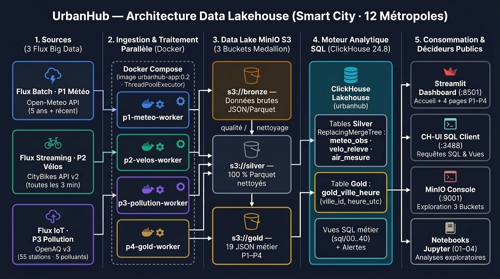
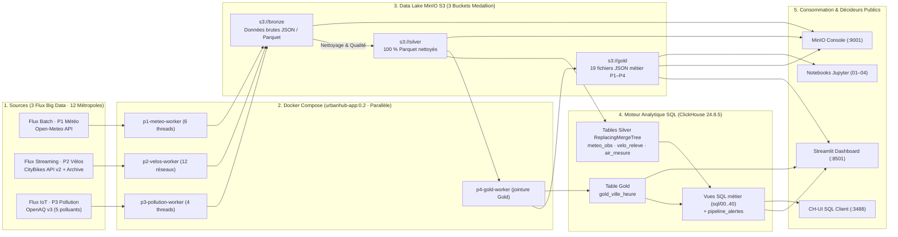

# UrbanHub — Jumeau numérique urbain (Architecture Data Lakehouse)

Projet Big Data Smart City. Plateforme **Data Lakehouse (MinIO S3 3 buckets Medallion + ClickHouse SQL + CH-UI)**
qui **collecte en parallèle, stocke, nettoie, analyse et visualise** des données urbaines (météo, vélos en libre-service,
pollution atmosphérique) pour produire des indicateurs utiles aux décideurs publics.

**12 métropoles françaises couvertes** : Paris, Lille, Marseille, Rouen, Lyon *(5 villes cœur)*,
Toulouse, Bordeaux, Nantes, Strasbourg, Montpellier, Rennes, Clermont-Ferrand.

---

## Les 4 parties & 17 questions métier

| Partie | Type de flux | Thème | Source | Questions métier |
|---|---|---|---|---|
| **P1** | Batch (durée paramétrable, défaut `1 semaine`, jusqu'à `5 ans`) | Météo | [Open-Meteo Archive & Forecast API](https://archive-api.open-meteo.com/) | Q1 périodes anormales · Q2 corrélation visibilité · Q3 saisonnalité · Q4 jours extrêmes |
| **P2** | Streaming (toutes les 3 min) + Backfill | Mobilité vélos | [CityBikes API v2](https://api.citybik.es/v2/) + [`data.citybik.es`](https://data.citybik.es/) | Q1 taux d'utilisation · Q2 sous-offre · Q3 pics journaliers · Q4 déséquilibres géo · Q5 rééquilibrage |
| **P3** | IoT (horaire, 55 stations · 164 capteurs) | Pollution de l'air | [OpenAQ API v3](https://docs.openaq.org) | Q1 zones polluées · Q2 variation journalière · Q3 polluants dominants · Q4 épisodes anormaux |
| **P4** | Analyse croisée Gold | Météo × Mobilité × Pollution | P1 + P2 + P3 | Q1 météo × pollution · Q2 météo × vélos · Q3 conditions favorables · Q4 interactions tripartites |

---

## Architecture Data Lakehouse (MinIO S3 + ClickHouse + CH-UI)





### Principes architecturaux clés

- **3 buckets MinIO S3 dédiés** :
  - `s3://bronze` : payloads bruts immuables issus des APIs (rejouables à tout moment) ;
  - `s3://silver` : **uniquement des fichiers Parquet** propres, typés, convertis et dédoublonnés ;
  - `s3://gold` : **uniquement des fichiers JSON métier** (19 livrables : 17 questions P1–P4, `gold_ville_heure.json`, `synthese_indicateurs_urbains.json` + alertes `gold/alertes/`).
- **Moteur SQL Lakehouse ClickHouse `24.8.5`** : tables `ReplacingMergeTree` partitionnées par mois (`toYYYYMM(...)`) et vues SQL métier (`sql/00..40`) interrogeables via **CH-UI (`http://localhost:3488`)**.
- **Parallélisme à double niveau** : 4 workers Docker en parallèle (**inter-flux**) + `ThreadPoolExecutor` interne (**intra-flux**) protégé par un `SharedRateLimiter` thread-safe (OpenAQ) et verrous `RLock` (MinIO / ClickHouse).
- **Temps universel & clé pivot** : toutes les observations sont stockées en **UTC** (sans aucune heure future de prévision) et jointes sur **`(ville_id, heure_utc)`**.
- **Durée de récupération paramétrable** : `FETCH_DURATION=1 semaine` par défaut (modulable en `jour(s)`, `semaine(s)`, `mois`, `année(s)` jusqu'à `5 ans` via `.env`, CLI `--duration` ou barre latérale Streamlit).

---

## Services Docker & Interfaces

| Service | Image | Ports | Rôle |
|---|---|---|---|
| `urbanhub-minio` | `pgsty/silo:RELEASE.2026-11-12T00-00-00Z` | `9000` (API) · `9001` (Console) | Data Lake S3 — 3 buckets `bronze`, `silver`, `gold` |
| `urbanhub-clickhouse` | `clickhouse/clickhouse-server:24.8.5` | `8123` (HTTP) · `9009` (Native) | Moteur analytique SQL Lakehouse (`urbanhub.*`) |
| `urbanhub-clickhouse-ui` | `ghcr.io/caioricciuti/ch-ui:v2.33.0` | `3488` | Client SQL web CH-UI |
| `urbanhub-p1-meteo` | `urbanhub-app:0.2` (`Dockerfile`) | — | Worker Batch parallèle P1 Météo |
| `urbanhub-p2-velos` | `urbanhub-app:0.2` (`Dockerfile`) | — | Worker Streaming parallèle P2 Vélos (3 min) |
| `urbanhub-p3-pollution` | `urbanhub-app:0.2` (`Dockerfile`) | — | Worker IoT parallèle P3 Pollution (horaire) |
| `urbanhub-p4-gold` | `urbanhub-app:0.2` (`Dockerfile`) | — | Worker Gold P4 (`s3://gold/*.json` + `gold_ville_heure`) |
| `urbanhub-streamlit` | `urbanhub-app:0.2` (`Dockerfile`) | `8501` | Dashboard interactif (Accueil + P1 à P4) |

---

## Arborescence

```
├── config/          villes.json, ref_ville.json, openaq_locations.json
├── common/          config, log, storage (MinIO 3 buckets / local), warehouse (ClickHouse), alerts, period
├── sql/             00_commun.sql, 10_p1_meteo.sql, 20_p2_velos.sql, 30_p3_pollution.sql, 40_gold.sql
├── scripts/         init_warehouse.py, init_datalake.py, run_all_parallel.py, check_sources.py
├── p1_meteo/        P1 : ingestion, cleaning, quality, analytics, flow
├── p2_velos/        P2 : ingestion, backfill, cleaning, quality, analytics, flow
├── p3_pollution/    P3 : openaq_client, explore, storage, ingestion, cleaning, quality, analytics, flow
├── p4_croise/       P4 : build_gold (19 JSON Gold + ClickHouse), analytics, flow
├── notebooks/       01_meteo.ipynb, 02_velos.ipynb, 03_pollution.ipynb, 04_croise.ipynb (connectés à MinIO S3)
├── dashboard/       Accueil.py + pages/ (1_Meteo, 2_Velos, 3_Pollution, 4_Croise)
├── docs/            architecture_lakehouse.jpg
├── tests/           62 tests unitaires (test_p1_*, test_p2_*, test_p3_*, test_p4_*, test_period, test_lakehouse)
├── Dockerfile       Image Python 3.11 partagée (urbanhub-app:0.2)
└── docker-compose.yml
```

---

## Documentation des modules

### Socle commun (`config/`, `common/`, `sql/`, `scripts/`)

| Module / Fichier | Utilité |
|---|---|
| `config/ref_ville.json` | Référentiel des 12 métropoles françaises (GPS, `bbox`, `network_id` CityBikes, `noaa_station_id`, `openaq_location_ids`). |
| `config/openaq_locations.json` | Sélection figée des 55 stations officielles OpenAQ v3 (164 capteurs actifs couvrant `PM2.5`, `PM10`, `NO2`, `O3`, `CO`). |
| `common/config.py` | Charge une seule fois la configuration (`Settings`) depuis `.env` (MinIO 3 buckets, ClickHouse, OpenAQ, `FETCH_DURATION`). |
| `common/storage.py` | Client MinIO multi-buckets thread-safe (`bronze`, `silver`, `gold`) + `LocalBronzeStorage` hors Docker. |
| `common/warehouse.py` | Client ClickHouse thread-safe (`ClickHouseWarehouse`, `get_warehouse`, `try_get_warehouse`, requêtes parallèles par année). |
| `common/period.py` | Parseur de durée flexible (`1, 2, 3... jour(s), semaine(s), mois, année(s)`, défaut `1 semaine`). |
| `common/alerts.py` | Journalise les alertes (`INFO`/`WARNING`/`CRITICAL`), les archive en JSON (`s3://gold/alertes/`) et dans `urbanhub.pipeline_alertes`. |
| `sql/00..40_*.sql` | Schéma ClickHouse Lakehouse : tables Silver/Gold `ReplacingMergeTree` partitionnées par mois + vues analytiques SQL P1–P4. |
| `scripts/init_warehouse.py` | Initialise idempotemment les 3 buckets MinIO, applique `sql/*.sql` dans ClickHouse et synchronise `urbanhub.ref_ville`. |
| `scripts/run_all_parallel.py` | Exécute P1, P2 et P3 en parallèle (`ThreadPoolExecutor`) puis régénère la couche Gold P4. |

### Partie 1 — Flux Batch Météo (`p1_meteo/`)

> **Choix de la source météo** : L'archive NOAA Global Hourly (`/data/global-hourly/access/`) ayant cessé de publier des données récentes en août 2025, le flux P1 s'appuie sur **Open-Meteo** (`archive-api` + `forecast` borné sur `[start_date, heure courante UTC]`), garantissant jusqu'à **5 ans d'historique** + **données jusqu'à l'heure courante** sans aucune heure future de prévision.

| Module / Fichier | Utilité |
|---|---|
| `p1_meteo/ingestion.py` | Téléchargement parallèle (`ThreadPoolExecutor`, 6 threads) + bornage temporel strict (`clip_hourly_payload`) → `s3://bronze/meteo/`. |
| `p1_meteo/cleaning.py` | Extraction des **8 variables** (`station_id`, `timestamp`, `temperature`, `pressure`, `wind_speed`, `wind_direction`, `precipitation`, `visibility`), conversion `km/h → m/s`, imputation/estimation visibilité → `s3://silver/meteo/*.parquet` + ClickHouse `meteo_obs`. |
| `p1_meteo/quality.py` | Bornes physiques, détection des sauts thermiques (`> 15 °C/h`), taux de complétude. |
| `p1_meteo/analytics.py` | Réponses Q1 (anomalies z-score ±15 j), Q2 (Spearman visibilité), Q3 (saisonnalité), Q4 (jours extrêmes). |
| `p1_meteo/flow.py` | Orchestration batch (`--daily`, `--duration`, `--local`). |

### Partie 2 — Flux Streaming Mobilité Vélos (`p2_velos/`)

| Module / Fichier | Utilité |
|---|---|
| `p2_velos/ingestion.py` | Collecte temps réel parallèle des 12 réseaux CityBikes v2 toutes les 3 min → `s3://bronze/velos/`. |
| `p2_velos/backfill.py` | Rattrapage historique parallèle par année sur `data.citybik.es` avec filtrage calendaire strict → `s3://bronze/velos_historique/` & `s3://silver/velos_historique/` + ClickHouse. |
| `p2_velos/quality.py` | Validation des **7 variables** (`station_id`, `station_name`, `latitude`, `longitude`, `bikes_available`, `free_slots`, `timestamp`), capacité, `bbox`, statut critique (`≤ 10 %` / `≥ 90 %`). |
| `p2_velos/cleaning.py` | Nettoyage & normalisation unifiés (streaming + historique) → `s3://silver/velos*/*.parquet`. |
| `p2_velos/analytics.py` | Réponses Q1–Q5 (utilisation, sous-offre, pics horaires, déséquilibres géo, plan de rééquilibrage `delta_velos_equilibre`). |
| `p2_velos/flow.py` | Orchestration continue (3 min) → MinIO Silver + ClickHouse `velo_releve` + alertes. |

### Partie 3 — Flux IoT Pollution Urbaine (`p3_pollution/`)

| Module / Fichier | Utilité |
|---|---|
| `p3_pollution/openaq_client.py` | Client OpenAQ v3 thread-safe avec `SharedRateLimiter` (60 req/min) et backoff exponentiel HTTP 429. |
| `p3_pollution/storage.py` | Abstraction MinIO 3 buckets (`bronze`/`silver`/`gold`) & local avec chargement automatique de `.env`. |
| `p3_pollution/ingestion.py` | Collecte IoT horaire (`/locations/{id}/latest`) et rattrapage (`/sensors/{id}/hours`) → `s3://bronze/openaq*`. |
| `p3_pollution/quality.py` | Conversion thermodynamique (`ppb`/`ppm`/`mg/m³ → µg/m³` à 20 °C, 1 013,25 hPa), bornes physiques, seuils OMS 2021 et ATMO. |
| `p3_pollution/cleaning.py` | Extraction des **7 variables** (`sensor_id`, `longitude`, `unit`, `pollutant`, `timestamp`, `latitude`, `value`), dédoublonnage → `s3://silver/pollution/*.parquet` + ClickHouse `air_mesure`. |
| `p3_pollution/analytics.py` | Réponses Q1 (zones polluées), Q2 (variation journalière), Q3 (polluants dominants), Q4 (épisodes anormaux). |

### Partie 4 — Analyse croisée & Couche Gold (`p4_croise/`)

| Module / Fichier | Utilité |
|---|---|
| `p4_croise/build_gold.py` | Jointure `(ville_id, heure_utc)` des 3 flux Silver, calcul des 5 indicateurs composites (`indice_confort_meteo`, `score_mobilite_douce`, `condition_favorable_velo`, `score_interaction_urbaine`, `regime_interaction`), export des **19 JSON métier** (`s3://gold/`) + chargement ClickHouse `urbanhub.gold_ville_heure`. |
| `p4_croise/analytics.py` | Réponses Q1 (Spearman météo × pollution), Q2 (météo × vélos), Q3 (conditions favorables), Q4 (interactions tripartites fortes). |
| `p4_croise/flow.py` | Orchestration Gold continue + alertes tripartites. |
| `dashboard/pages/4_Croise.py` | Dashboard P4 (verdicts chiffrés dynamiques, glossaire des formules, inspection/téléchargement Gold JSON). |
| `notebooks/04_croise.ipynb` | Notebook exploratoire P4 avec dictionnaire complet des métriques et connexion prioritaire à MinIO S3. |

---

## Démarrage rapide (Data Lakehouse complet)

```powershell
# 1. Cloner et préparer l'environnement Python local (notebooks & tests)
git clone https://github.com/LyesBoumrah/UrbanHub.git
cd UrbanHub
python -m venv .venv
.venv\Scripts\activate          # Windows (Linux/Mac : source .venv/bin/activate)
pip install -r requirements.txt

# 2. Configurer .env (renseigner OPENAQ_API_KEY ; défaut FETCH_DURATION=1 semaine)
cp .env.example .env

# 3. Construire l'image mutualisée et lancer les 8 services Lakehouse
docker compose up -d --build
docker compose ps

# 4. (Optionnel) Exécuter manuellement les 3 flux en parallèle + Gold
python scripts/run_all_parallel.py --duration "1 semaine"

# 5. Vérifier la qualité logicielle et la suite complète de tests
flake8 .
pytest -q
```

### Accès aux interfaces
- **Dashboard Streamlit** : `http://localhost:8501`
- **Client SQL ClickHouse (CH-UI)** : `http://localhost:3488`
  ```sql
  SELECT * FROM urbanhub.v_gold_synthese_villes;
  SELECT * FROM urbanhub.v_gold_interactions_fortes;
  SELECT * FROM urbanhub.v_velo_stations_critiques LIMIT 20;
  ```
- **Console MinIO S3 (3 buckets `bronze`, `silver`, `gold`)** : `http://localhost:9001`
- **Notebooks Jupyter (`notebooks/01..04`)** : ouvrir dans VS Code avec le kernel `.venv` puis cliquer sur **Run All** (lecture prioritaire depuis MinIO S3 `localhost:9000`).

> Les données ne sont **pas** versionnées : chacun les régénère automatiquement via `docker compose up -d` ou `scripts/run_all_parallel.py`.
