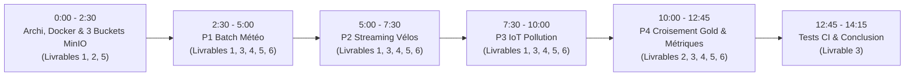

# 🎬 Guide complet d'enregistrement vidéo — Présentation solo UrbanHub (≤ 15 min)

Ce guide est calibré pour une **présentation en solo de 13 min 30 à 14 min 30** (marge de sécurité de **30 à 90 secondes** sous le plafond strict des **15 minutes**). Il regroupe tout ce dont vous avez besoin pour présenter sereinement votre travail : **fiche mémo express**, **preuve des 6 livrables**, **script minuté mot-pour-mot**, **explications simples de Spearman et de chaque métrique**, **défis techniques résolus** et **réponses aux questions du jury**.

---

## 0. Fiche Mémo Express (à garder sous les yeux pendant le record)

> [!TIP]
> Si vous avez un trou de mémoire pendant le tournage, suivez simplement ces **6 étapes** :
> 1. **0:00 – 2:30 · Architecture & Stockage** → `README.md` + `docker-compose.yml` + **Console MinIO** (`3 buckets : bronze, silver, gold`) + **Streamlit Accueil** (scorecard 12 villes + 17 livrables Gold).
> 2. **2:30 – 5:00 · P1 Batch Météo** → `p1_meteo/ingestion.py` (Open-Meteo parallèle + bornage strict) → `01_meteo.ipynb` → **Streamlit `1_Meteo`** (Q1–Q4).
> 3. **5:00 – 7:30 · P2 Streaming Vélos** → `docker compose logs p2-velos-worker` → `p2_velos/cleaning.py` → `02_velos.ipynb` → **Streamlit `2_Velos`** (Q1–Q5 + plan de rééquilibrage).
> 4. **7:30 – 10:00 · P3 IoT Pollution** → `openaq_client.py` (`SharedRateLimiter`) + `quality.py` (`µg/m³` + OMS 2021) → `03_pollution.ipynb` → **Streamlit `3_Pollution`** (Q1–Q4).
> 5. **10:00 – 12:45 · P4 Croisement Gold** → `p4_croise/build_gold.py` → **MinIO bucket `gold`** → **Streamlit `4_Croise`** (ouvrir `📘 Glossaire`, parcourir Q1–Q4 + 1 Gold JSON) → `04_croise.ipynb`.
> 6. **12:45 – 14:15 · Qualité & Conclusion** → PowerShell `flake8 .` (`0 erreur`) + `pytest -q` (`58 tests passés`) → `.github/workflows/ci.yml` → mot de conclusion.

**Chiffres clés à retenir :**
- **12 métropoles françaises** (5 villes cœur : Paris, Lille, Marseille, Rouen, Lyon + 7 extensions)
- **3 types de flux en parallèle** : Batch (P1 Open-Meteo, 8 variables) · Streaming 3 min (P2 CityBikes, 7 variables) · IoT horaire (P3 OpenAQ v3, 55 stations / 164 capteurs, 7 variables, 5 polluants `PM2.5, PM10, NO2, O3, CO`)
- **3 buckets MinIO dédiés** : `s3://bronze` (brut API) → `s3://silver` (100 % Parquet) → `s3://gold` (**19 fichiers JSON métier** : 17 réponses Q1–Q4/Q5 + table croisée + synthèse exécutive)
- **Clé pivot unique** : `(ville_id, heure_utc)` en **UTC**
- **Qualité logicielle** : **58 tests `pytest`**, **0 warning**, **0 erreur `flake8`**, **image Docker unique `urbanhub-app:0.1`**

---

## 1. Matrice de preuve — Couverture des 6 livrables attendus

| # | Livrable attendu | Preuves concrètes montrées à l'écran | Séquence |
| :-: | :--- | :--- | :---: |
| **1** | **Scripts de collecte des données** | Parallélisme inter-flux ([docker-compose.yml](file:///d:/IPSSI/Architecture%20Data%20Lake%20Data%20WareHouse%20DataLake%20House/Projets/UrbanHub/docker-compose.yml) + [run_all_parallel.py](file:///d:/IPSSI/Architecture%20Data%20Lake%20Data%20WareHouse%20DataLake%20House/Projets/UrbanHub/scripts/run_all_parallel.py)) & intra-flux (`ThreadPoolExecutor`) : Batch P1 ([p1_meteo/ingestion.py](file:///d:/IPSSI/Architecture%20Data%20Lake%20Data%20WareHouse%20DataLake%20House/Projets/UrbanHub/p1_meteo/ingestion.py)), Streaming P2 ([p2_velos/ingestion.py](file:///d:/IPSSI/Architecture%20Data%20Lake%20Data%20WareHouse%20DataLake%20House/Projets/UrbanHub/p2_velos/ingestion.py) + [backfill.py](file:///d:/IPSSI/Architecture%20Data%20Lake%20Data%20WareHouse%20DataLake%20House/Projets/UrbanHub/p2_velos/backfill.py)), IoT P3 ([p3_pollution/ingestion.py](file:///d:/IPSSI/Architecture%20Data%20Lake%20Data%20WareHouse%20DataLake%20House/Projets/UrbanHub/p3_pollution/ingestion.py) + `SharedRateLimiter`). Durée paramétrable (`1 semaine` par défaut jusqu'à `5 ans` via [common/period.py](file:///d:/IPSSI/Architecture%20Data%20Lake%20Data%20WareHouse%20DataLake%20House/Projets/UrbanHub/common/period.py)). | Séq. 1–4 |
| **2** | **Stockage structuré des données** | **Console MinIO S3** (`http://localhost:9001`) : **3 buckets dédiés Medallion** `bronze` (bruts immuables) → `silver` (**100 % Parquet**) → `gold` (**100 % JSON métier**, 19 fichiers) + référentiel [config/ref_ville.json](file:///d:/IPSSI/Architecture%20Data%20Lake%20Data%20WareHouse%20DataLake%20House/Projets/UrbanHub/config/ref_ville.json) & [common/storage.py](file:///d:/IPSSI/Architecture%20Data%20Lake%20Data%20WareHouse%20DataLake%20House/Projets/UrbanHub/common/storage.py). | Séq. 1 & 5 |
| **3** | **Pipeline de traitement** | Nettoyage, conversion d'unités (`km/h → m/s`, `ppb/ppm → µg/m³`), contrôle qualité, dédoublonnage, bornage temporel (0 heure future), alertes JSON et orchestration continue : `cleaning.py`, `quality.py`, `flow.py`, [p4_croise/build_gold.py](file:///d:/IPSSI/Architecture%20Data%20Lake%20Data%20WareHouse%20DataLake%20House/Projets/UrbanHub/p4_croise/build_gold.py), [Dockerfile](file:///d:/IPSSI/Architecture%20Data%20Lake%20Data%20WareHouse%20DataLake%20House/Projets/UrbanHub/Dockerfile), **58 tests `pytest`** & CI GitHub Actions. | Séq. 2–6 |
| **4** | **Analyses exploratoires** | Les **4 Jupyter Notebooks** exécutés dans VS Code : [01_meteo.ipynb](file:///d:/IPSSI/Architecture%20Data%20Lake%20Data%20WareHouse%20DataLake%20House/Projets/UrbanHub/notebooks/01_meteo.ipynb), [02_velos.ipynb](file:///d:/IPSSI/Architecture%20Data%20Lake%20Data%20WareHouse%20DataLake%20House/Projets/UrbanHub/notebooks/02_velos.ipynb), [03_pollution.ipynb](file:///d:/IPSSI/Architecture%20Data%20Lake%20Data%20WareHouse%20DataLake%20House/Projets/UrbanHub/notebooks/03_pollution.ipynb), [04_croise.ipynb](file:///d:/IPSSI/Architecture%20Data%20Lake%20Data%20WareHouse%20DataLake%20House/Projets/UrbanHub/notebooks/04_croise.ipynb) (incluant le dictionnaire complet des métriques) + moteurs analytiques `analytics.py`. | Séq. 2–5 |
| **5** | **Visualisations** | **Dashboard Streamlit** (`http://localhost:8501`) : page d'accueil exécutive [Accueil.py](file:///d:/IPSSI/Architecture%20Data%20Lake%20Data%20WareHouse%20DataLake%20House/Projets/UrbanHub/dashboard/Accueil.py) + 4 pages interactives (`1_Meteo`, `2_Velos`, `3_Pollution`, `4_Croise`) avec filtres villes/durées, cartes géographiques, heatmaps Spearman, courbes diurnes/saisonnières, glossaire des formules et téléchargement JSON Gold. | Séq. 1–5 |
| **6** | **Interprétation des résultats** | Verdicts chiffrés dynamiques sur les **17 questions métier** (P1 Q1–Q4, P2 Q1–Q5, P3 Q1–Q4, P4 Q1–Q4), recommandations opérationnelles (rééquilibrage vélos, itinéraires cyclables apaisés, alertes ozone/intempéries) et synthèse exécutive `s3://gold/synthese_indicateurs_urbains.json`. | Séq. 2–5 |

---

## 2. Préparation avant d'appuyer sur *Record* (5 minutes avant)

> [!IMPORTANT]
> Préparez l'environnement **avant** de lancer l'enregistrement pour éviter toute attente pendant la vidéo.

### Étape A — Vérifier `.env` et démarrer la stack Docker
1. Vérifiez dans [.env](file:///d:/IPSSI/Architecture%20Data%20Lake%20Data%20WareHouse%20DataLake%20House/Projets/UrbanHub/.env) :
   - `OPENAQ_API_KEY` renseignée
   - `MINIO_BUCKET_BRONZE=bronze`, `MINIO_BUCKET_SILVER=silver`, `MINIO_BUCKET_GOLD=gold`
   - `FETCH_DURATION=1 semaine` *(ou `1 mois` si vous souhaitez montrer un peu plus d'historique ; la démo fonctionne parfaitement dès `1 semaine`)*
2. Construisez une seule fois l'image mutualisée et démarrez les 6 conteneurs en parallèle :
```powershell
docker compose up -d --build
docker compose ps
```
3. Vérifiez dans les logs que les 4 workers ont terminé au moins un cycle complet :
```powershell
docker compose logs --tail 12 p1-meteo-worker p2-velos-worker p3-pollution-worker p4-gold-worker
```
*(Si vous voulez forcer immédiatement le rafraîchissement Gold après un premier cycle : `docker compose exec p4-gold-worker python -m p4_croise.flow`.)*

### Étape B — Préparer vos 4 espaces de travail (1920×1080, zoom 110 %)
1. **Navigateur — Onglet 1 (`http://localhost:8501`)** : cliquez une fois sur `Accueil`, `1_Meteo`, `2_Velos`, `3_Pollution` et `4_Croise` pour chauffer le cache Streamlit. Vérifiez que la source affichée est bien **MinIO S3 (`s3://silver` / `s3://gold`)**.
2. **Navigateur — Onglet 2 (`http://localhost:9001`)** : connecté sur la **Console MinIO S3**, ouvert sur la vue racine montrant uniquement les **3 buckets `bronze`, `silver` et `gold`**.
3. **VS Code** : police ≥ 14 pt, onglets pré-ouverts dans l'ordre exact de passage :
   - [README.md](file:///d:/IPSSI/Architecture%20Data%20Lake%20Data%20WareHouse%20DataLake%20House/Projets/UrbanHub/README.md) · [docker-compose.yml](file:///d:/IPSSI/Architecture%20Data%20Lake%20Data%20WareHouse%20DataLake%20House/Projets/UrbanHub/docker-compose.yml) · [Dockerfile](file:///d:/IPSSI/Architecture%20Data%20Lake%20Data%20WareHouse%20DataLake%20House/Projets/UrbanHub/Dockerfile)
   - [p1_meteo/ingestion.py](file:///d:/IPSSI/Architecture%20Data%20Lake%20Data%20WareHouse%20DataLake%20House/Projets/UrbanHub/p1_meteo/ingestion.py) · [p1_meteo/cleaning.py](file:///d:/IPSSI/Architecture%20Data%20Lake%20Data%20WareHouse%20DataLake%20House/Projets/UrbanHub/p1_meteo/cleaning.py) · [notebooks/01_meteo.ipynb](file:///d:/IPSSI/Architecture%20Data%20Lake%20Data%20WareHouse%20DataLake%20House/Projets/UrbanHub/notebooks/01_meteo.ipynb)
   - [p2_velos/ingestion.py](file:///d:/IPSSI/Architecture%20Data%20Lake%20Data%20WareHouse%20DataLake%20House/Projets/UrbanHub/p2_velos/ingestion.py) · [p2_velos/cleaning.py](file:///d:/IPSSI/Architecture%20Data%20Lake%20Data%20WareHouse%20DataLake%20House/Projets/UrbanHub/p2_velos/cleaning.py) · [notebooks/02_velos.ipynb](file:///d:/IPSSI/Architecture%20Data%20Lake%20Data%20WareHouse%20DataLake%20House/Projets/UrbanHub/notebooks/02_velos.ipynb)
   - [p3_pollution/openaq_client.py](file:///d:/IPSSI/Architecture%20Data%20Lake%20Data%20WareHouse%20DataLake%20House/Projets/UrbanHub/p3_pollution/openaq_client.py) · [p3_pollution/quality.py](file:///d:/IPSSI/Architecture%20Data%20Lake%20Data%20WareHouse%20DataLake%20House/Projets/UrbanHub/p3_pollution/quality.py) · [notebooks/03_pollution.ipynb](file:///d:/IPSSI/Architecture%20Data%20Lake%20Data%20WareHouse%20DataLake%20House/Projets/UrbanHub/notebooks/03_pollution.ipynb)
   - [p4_croise/build_gold.py](file:///d:/IPSSI/Architecture%20Data%20Lake%20Data%20WareHouse%20DataLake%20House/Projets/UrbanHub/p4_croise/build_gold.py) · [notebooks/04_croise.ipynb](file:///d:/IPSSI/Architecture%20Data%20Lake%20Data%20WareHouse%20DataLake%20House/Projets/UrbanHub/notebooks/04_croise.ipynb)
4. **Terminal PowerShell** propre (`Clear-Host`), à la racine du projet avec `.venv` activé.

---

## 3. Conducteur minuté de l'enregistrement (Storyboard 14 min)



---

### ⏱️ Séquence 1 (0:00 – 2:30) — Vision Smart City, Parallélisme & 3 Buckets MinIO
**Livrables validés : `1. Collecte` · `2. Stockage structuré` · `5. Visualisations`** · *Balise fin : **2:30***

**À montrer à l'écran :**
1. Schéma d'architecture dans [README.md](file:///d:/IPSSI/Architecture%20Data%20Lake%20Data%20WareHouse%20DataLake%20House/Projets/UrbanHub/README.md#L19-L36), puis [docker-compose.yml](file:///d:/IPSSI/Architecture%20Data%20Lake%20Data%20WareHouse%20DataLake%20House/Projets/UrbanHub/docker-compose.yml) (6 services partageant l'image unique `urbanhub-app:0.1` via [Dockerfile](file:///d:/IPSSI/Architecture%20Data%20Lake%20Data%20WareHouse%20DataLake%20House/Projets/UrbanHub/Dockerfile)).
2. **Console MinIO** (`http://localhost:9001`) : montrer les **3 buckets dédiés** `bronze`, `silver`, `gold` et cliquer brièvement dans chacun (`bronze/meteo, velos, openaq` → `silver/*.parquet` → `gold/*.json`).
3. **Streamlit — Page `Accueil`** (`http://localhost:8501`) : montrer les compteurs des 3 buckets, la **période réelle par flux**, le tableau des indicateurs consolidés par ville et ouvrir 5 s l'accordéon **`Couverture des questions métier en couche Gold (17 livrables JSON)`**.

**Discours solo :**
- *"Bonjour. Je vais vous présenter **UrbanHub**, le jumeau numérique urbain que j'ai développé pour transformer des flux hétérogènes Smart City en indicateurs d'aide à la décision publique. Il couvre **12 métropoles françaises** autour des 3 grands types de flux Big Data : **Batch** météo (P1), **Streaming** vélos toutes les 3 minutes (P2) et **IoT** pollution atmosphérique (P3)."*
- *"Toute la stack tourne sous Docker Compose sur une **image mutualisée** (`Dockerfile`), avec un **parallélisme à double niveau** : les 4 workers tournent simultanément (inter-flux), et chaque worker parallélise ses appels API via `ThreadPoolExecutor` (intra-flux)."*
- *"Côté stockage, j'ai implémenté une architecture **100 % Data Lake Medallion sur MinIO S3 avec 3 buckets dédiés** :"*
  - **`bronze`** : données brutes immuables issues des APIs, rejouables à tout moment ;
  - **`silver`** : **uniquement des fichiers Parquet** propres, typés, dédoublonnés et validés ;
  - **`gold`** : **uniquement des fichiers JSON métier** (19 fichiers : les 17 réponses directes aux questions P1–P4, la table croisée `gold_ville_heure.json` et la synthèse exécutive `synthese_indicateurs_urbains.json`), tous alignés sur la clé pivot **`(ville_id, heure_utc)`** en UTC.
- **Transition** *(Alt+Tab vers VS Code)* : *"Je vais maintenant vous montrer chaque flux bout-en-bout — collecte, traitement, notebook exploratoire, visualisations et interprétation — en commençant par la Partie 1."*

---

### ⏱️ Séquence 2 (2:30 – 5:00) — Partie 1 : Flux Batch Météo (Open-Meteo)
**Livrables validés : `1` · `3` · `4` · `5` · `6`** · *Balise fin : **5:00***

**À montrer à l'écran :**
1. **Collecte & bornage** : montrer `ThreadPoolExecutor`, `merge_archive_and_recent` et `clip_hourly_payload` dans [p1_meteo/ingestion.py](file:///d:/IPSSI/Architecture%20Data%20Lake%20Data%20WareHouse%20DataLake%20House/Projets/UrbanHub/p1_meteo/ingestion.py#L129-L315).
2. **Nettoyage & Qualité** : survoler 15 s [p1_meteo/cleaning.py](file:///d:/IPSSI/Architecture%20Data%20Lake%20Data%20WareHouse%20DataLake%20House/Projets/UrbanHub/p1_meteo/cleaning.py) (8 variables, `km/h → m/s`, filtrage des heures futures) et [notebooks/01_meteo.ipynb](file:///d:/IPSSI/Architecture%20Data%20Lake%20Data%20WareHouse%20DataLake%20House/Projets/UrbanHub/notebooks/01_meteo.ipynb).
3. **Streamlit `1_Meteo`** : montrer le sélecteur de durée dans la barre latérale (`1 semaine` par défaut, modulable en jours/semaines/mois/années) et cliquer dans les **4 onglets Q1 à Q4**.

**Discours solo :**
- **Justification source** : *"J'ai d'abord testé NOAA Global Hourly, mais l'archive a cessé de publier des données récentes en août 2025, ce qui bloquait le croisement temps réel avec CityBikes et OpenAQ. J'ai donc connecté P1 à **Open-Meteo** (`archive-api` + `forecast` borné sur la fenêtre demandée jusqu'à l'heure courante UTC, sans aucune heure de prévision future), récupérant en parallèle les **8 variables exigées** (`station_id`, `timestamp`, `temperature`, `pressure`, `wind_speed`, `wind_direction`, `precipitation`, `visibility`)."*
- **Nettoyage** : *"Conversion du vent `km/h → m/s` (÷ 3,6), timestamps UTC, interpolation linéaire courte (≤ 3 h), estimation physique de la visibilité sur les trous anciens, rejet des valeurs hors bornes et des sauts thermiques > 15 °C/h."*
- **Interprétation Q1–Q4** :
  - **Q1 (Périodes anormales)** : z-score journalier désaisonnalisé (± 15 jours) sur 4 variables (`tmoy`, pression, vent, pluie) pour détecter vagues de chaleur/froid et tempêtes.
  - **Q2 (Météo ↔ Visibilité)** : corrélation de **Spearman** fortement négative avec l'humidité relative (brouillard < 1 000 m dès HR > 95 %) et la pluie ; le vent disperse le brouillard.
  - **Q3 (Saisonnalité)** : contraste net entre climats continental (Strasbourg/Lyon), océanique (Nantes/Lille) et méditerranéen (Marseille/Montpellier).
  - **Q4 (Jours extrêmes)** : détection multi-critères (canicule ≥ 35 °C, gel fort ≤ -5 °C, vent ≥ 15 m/s, pluie ≥ 30 mm/j, dépression < 980 hPa, records P99/P1).
- **Transition** *(vers PowerShell)* : *"Après ce flux Batch, je passe au deuxième type de flux : le Streaming temps réel de mobilité urbaine."*

---

### ⏱️ Séquence 3 (5:00 – 7:30) — Partie 2 : Flux Streaming Vélos (CityBikes)
**Livrables validés : `1` · `3` · `4` · `5` · `6`** · *Balise fin : **7:30***

**À montrer à l'écran :**
1. **Preuve Streaming live** dans PowerShell (3 secondes) :
   ```powershell
   docker compose logs --tail 15 p2-velos-worker
   ```
2. **Code Collecte & Traitement** : survoler 15 s [p2_velos/ingestion.py](file:///d:/IPSSI/Architecture%20Data%20Lake%20Data%20WareHouse%20DataLake%20House/Projets/UrbanHub/p2_velos/ingestion.py), [p2_velos/cleaning.py](file:///d:/IPSSI/Architecture%20Data%20Lake%20Data%20WareHouse%20DataLake%20House/Projets/UrbanHub/p2_velos/cleaning.py) et [notebooks/02_velos.ipynb](file:///d:/IPSSI/Architecture%20Data%20Lake%20Data%20WareHouse%20DataLake%20House/Projets/UrbanHub/notebooks/02_velos.ipynb).
3. **Streamlit `2_Velos`** : montrer la source `s3://silver/velos*`, les 5 KPIs, la barre latérale séparant clairement **Streaming temps réel** et **Backfill historique (`data.citybik.es`)**, puis parcourir les **5 onglets Q1 à Q5**.

**Discours solo :**
- **Collecte & Traitement** : *"Le worker P2 interroge en parallèle les 12 réseaux CityBikes v2 toutes les 3 minutes (complété par un backfill historique sur l'archive officielle `data.citybik.es`, filtré strictement sur la fenêtre calendaire demandée). J'extrais les **7 variables** (`station_id`, `station_name`, `latitude`, `longitude`, `bikes_available`, `free_slots`, `timestamp`), je contrôle la cohérence capacité/bounding-box, je dédoublonne et je calcule `taux_occupation` (`bikes/capacity`), `taux_utilisation` (`free_slots/capacity`) et `est_critique` (≤ 10 % ou ≥ 90 %)."*
- **Interprétation Q1–Q5** :
  - **Q1 (Fort taux d'utilisation)** : Top 50 national + Top 10 par ville (pôles de transport et centres denses).
  - **Q2 (Zones sous-dotées)** : grille spatiale détectant les quartiers chroniquement en pénurie (≤ 15 % de vélos).
  - **Q3 (Pics journaliers)** : double pic pendulaire en semaine (08h / 18h) contre pic unique d'après-midi le week-end.
  - **Q4 (Déséquilibres géographiques)** : comparaison Centre (< 1,5 km) vs quadrants Nord/Sud/Est/Ouest.
  - **Q5 (Stations critiques & rééquilibrage)** : plan opérationnel classant chaque station en `REAPPROVISIONNER` ou `DESENGORGER` avec le nombre exact de vélos (`delta_velos_equilibre`) pour revenir à 50 % d'occupation.
- **Transition** *(vers VS Code P3)* : *"Voyons maintenant le troisième flux : les capteurs IoT de qualité de l'air via OpenAQ v3."*

---

### ⏱️ Séquence 4 (7:30 – 10:00) — Partie 3 : Flux IoT Pollution Urbaine (OpenAQ v3)
**Livrables validés : `1` · `3` · `4` · `5` · `6`** · *Balise fin : **10:00***

**À montrer à l'écran :**
1. **Collecte IoT & Rate Limiting** : montrer [config/openaq_locations.json](file:///d:/IPSSI/Architecture%20Data%20Lake%20Data%20WareHouse%20DataLake%20House/Projets/UrbanHub/config/openaq_locations.json) (55 stations officielles EEA, 164 capteurs) et `SharedRateLimiter` dans [p3_pollution/openaq_client.py](file:///d:/IPSSI/Architecture%20Data%20Lake%20Data%20WareHouse%20DataLake%20House/Projets/UrbanHub/p3_pollution/openaq_client.py).
2. **Traitement & Qualité** : montrer `convert_to_ugm3` et les seuils OMS 2021 dans [p3_pollution/quality.py](file:///d:/IPSSI/Architecture%20Data%20Lake%20Data%20WareHouse%20DataLake%20House/Projets/UrbanHub/p3_pollution/quality.py#L84-L129) + aperçu rapide de [notebooks/03_pollution.ipynb](file:///d:/IPSSI/Architecture%20Data%20Lake%20Data%20WareHouse%20DataLake%20House/Projets/UrbanHub/notebooks/03_pollution.ipynb).
3. **Streamlit `3_Pollution`** : montrer la carte des capteurs et les **4 onglets Q1 à Q4**.

**Discours solo :**
- **Collecte & Traitement** : *"Mon client OpenAQ v3 multi-thread utilise un `SharedRateLimiter` thread-safe avec backoff exponentiel sur HTTP 429 pour respecter le quota API (60 req/min). Il extrait les **7 variables** (`sensor_id`, `longitude`, `unit`, `pollutant`, `timestamp`, `latitude`, `value`) sur les **5 polluants principaux** (`PM2.5`, `PM10`, `NO2`, `O3`, `CO`). Toutes les unités (`ppb`, `ppm`, `mg/m³`) sont converties en `µg/m³` par masse molaire (à 20 °C et 1 013,25 hPa), puis rapportées aux **seuils journaliers OMS 2021** via le `ratio_oms`."*
- **Interprétation Q1–Q4** :
  - **Q1 (Zones les plus polluées)** : classement des villes, des stations et Top 5 dédié à chacun des 5 polluants (pics près des axes routiers denses).
  - **Q2 (Variation journalière)** : double pic trafic (07h–09h et 18h–21h) pour NO₂/PM/CO, en opposition de phase avec l'ozone (O₃, secondaire photochimique) qui culmine à 14h–17h.
  - **Q3 (Polluants dominants)** : distinction entre dominance **sanitaire** (ratio OMS : NO₂ et PM2.5) et dominance **en masse brute** hors CO (O₃ et PM10).
  - **Q4 (Épisodes anormaux)** : détection automatique des épisodes continus (≥ 3 h au-dessus du seuil ATMO ou z-score ≥ 2 + dépassement OMS) et pics horaires critiques, avec archivage d'alertes JSON dans `s3://gold/alertes/`.
- **Transition** *(vers `p4_croise/build_gold.py` puis Streamlit `4_Croise`)* : *"Une fois les 3 flux nettoyés en Parquet dans le bucket `silver`, je passe à la valeur ajoutée centrale d'UrbanHub : l'analyse croisée Gold."*

---

### ⏱️ Séquence 5 (10:00 – 12:45) — Partie 4 : Analyse Croisée Gold, Métriques & Décideurs
**Livrables validés : `2. Gold JSON` · `3. Pipeline Gold` · `4. Exploration` · `5. Visualisations` · `6. Interprétation`** · *Balise fin : **12:45***

**À montrer à l'écran :**
1. **Pipeline Gold** : montrer rapidement `enrich_gold_indicators` dans [p4_croise/build_gold.py](file:///d:/IPSSI/Architecture%20Data%20Lake%20Data%20WareHouse%20DataLake%20House/Projets/UrbanHub/p4_croise/build_gold.py#L191-L260) et le dictionnaire des métriques dans [notebooks/04_croise.ipynb](file:///d:/IPSSI/Architecture%20Data%20Lake%20Data%20WareHouse%20DataLake%20House/Projets/UrbanHub/notebooks/04_croise.ipynb).
2. **Streamlit `4_Croise`** :
   - Montrer le **bandeau de couverture des 3 flux**, les **5 KPIs** et ouvrir 10 secondes **`📘 Glossaire & Formules détaillées des métriques utilisées`** pour prouver la transparence des calculs.
   - Parcourir les **4 onglets Q1 à Q4** en lisant chaque **verdict chiffré vert (`st.success`)** :
     - **Q1** : Heatmap de **Spearman** + barres dispersion vent/pluie + courbes température.
     - **Q2** : Barres température × pluie + corrélations météo ↔ vélos + sensibilité par ville.
     - **Q3** : 5 critères favorables + comparaison favorable/défavorable + profil horaire `0h–23h` ou saisonnier.
     - **Q4** : Camembert des régimes urbains + nuage de points / chronologie + tableau des épisodes continus + ouvrir 1 expander **`📄 Inspecter le fichier Gold JSON`** (téléchargeable).

**Discours solo :**
- **Jointure & Métriques Gold** : *"La couche Gold joint P1, P2 et P3 sur `(ville_id, heure_utc)` et fabrique 5 indicateurs métier transparents (tous détaillés dans le glossaire intégré) : `indice_confort_meteo` (/100), `score_mobilite_douce` (75 % météo + 25 % air), `condition_favorable_velo` (5 critères simultanés), `score_interaction_urbaine` (/100) et `regime_interaction` (5 classes)."*
- **Pourquoi Spearman** : *"J'utilise la corrélation de rang de **Spearman** (ρ entre -1 et +1) car les liaisons météo/pollution sont non linéaires et exposées à des valeurs extrêmes ; Spearman reste robuste là où Pearson serait biaisé."*
- **Interprétation Q1–Q4 & Aide à la décision** :
  - **Q1 (Météo × Pollution)** : dispersion éolienne nette (vent soutenu divise l'indice OMS), lessivage des particules par la pluie et couplage chaleur–ozone.
  - **Q2 (Météo × Vélos)** : optimum thermique autour de 12–26 °C et décrochage marqué sous pluie forte (> 1 mm/h).
  - **Q3 (Conditions favorables)** : créneaux réunissant `10–26 °C`, sec `≤ 0,2 mm/h`, vent `≤ 6 m/s`, visibilité `≥ 4 km` et `indice OMS ≤ 1,2x`, avec mesure du gain net de fréquentation vélo.
  - **Q4 (Interactions tripartites fortes)** : détection de régimes directement actionnables par une collectivité :
    - `exposition_cyclistes_pointe` → recommander des itinéraires cyclables secondaires éloignés des grands axes ;
    - `episode_photochimique_chaleur` → limiter les efforts entre 14h et 17h et activer les îlots de fraîcheur ;
    - `intemperies_report_modal` → anticiper le report modal vers bus/métro.
- **Transition** *(vers PowerShell)* : *"Pour terminer, je valide en direct l'industrialisation et la qualité du code."*

---

### ⏱️ Séquence 6 (12:45 – 14:15) — Qualité logicielle, Tests CI & Conclusion
**Livrables validés : `3. Pipeline de traitement (industrialisation)`** · *Arrêt du record : **≤ 14:30***

**À montrer à l'écran :**
1. Lancer dans PowerShell :
   ```powershell
   .venv\Scripts\python.exe -m flake8 .
   .venv\Scripts\python.exe -m pytest -q
   ```
2. Afficher 5 secondes [.github/workflows/ci.yml](file:///d:/IPSSI/Architecture%20Data%20Lake%20Data%20WareHouse%20DataLake%20House/Projets/UrbanHub/.github/workflows/ci.yml).

**Discours solo :**
- *"L'ensemble de la plateforme est vérifié par `flake8` (**0 erreur**) et **58 tests unitaires `pytest`** (**0 warning**) dans GitHub Actions CI — testant le parallélisme réel, les conversions d'unités, le bornage sans heures futures, le routage multi-buckets MinIO (`bronze`, `silver`, `gold`) sans deadlock, et l'intégrité des 19 livrables Gold JSON."*
- **Conclusion** : *"UrbanHub réunit ainsi les 6 livrables attendus dans une plateforme Smart City complète, reproductible par un seul `docker compose up`, capable de transformer 3 flux Big Data hétérogènes en indicateurs urbains immédiatement exploitables par des décideurs publics. Merci pour votre attention."*

---

## 4. Contrôle chronomètre solo (plafond strict 15 min)

Placez un timer visible à côté de l'écran et vérifiez ces **5 balises** :

| Balise | Heure cible | Action immédiate si vous avez +30 s de retard |
| :--- | :---: | :--- |
| **Fin Séq. 1 (Archi + MinIO)** | **2:30** | Survolez `Accueil` en 15 s sans ouvrir l'accordéon des 17 questions. |
| **Fin Séq. 2 (P1 Météo)** | **5:00** | Sur P2, ne montrez pas `02_velos.ipynb` — passez directement à Streamlit `2_Velos`. |
| **Fin Séq. 3 (P2 Vélos)** | **7:30** | Sur P3, montrez uniquement `SharedRateLimiter` + `convert_to_ugm3` (20 s max). |
| **Fin Séq. 4 (P3 Pollution)** | **10:00** | Sur P4, survolez `build_gold.py` en 15 s et passez vite à Streamlit `4_Croise`. |
| **Fin Séq. 5 (P4 Croisé)** | **12:45** | Utilisez `pytest -q` (4 s) au lieu de `pytest -v` pour conclure à **14:00**. |

---

## 5. Explications simples des métriques & de Spearman (à dire à l'oral)

### Comment expliquer la corrélation de Spearman (ρ) en 15 secondes
> *« La corrélation de **Spearman** (notée ρ, comprise entre `-1` et `+1`) remplace chaque valeur par son **rang** avant de calculer la corrélation : proche de `+1` les deux variables montent ensemble (ex. température et ozone), proche de `-1` l'une baisse quand l'autre monte (ex. vent et PM2.5, ou humidité et visibilité), proche de `0` il n'y a pas de tendance monotone. Je l'ai choisie plutôt que Pearson parce que les phénomènes météo/pollution sont **non linéaires** et comportent des **pics extrêmes** qui fausseraient Pearson — et en Q2 je la complète par des barres par classes de température pour capter l'effet en cloche du vélo autour de 19 °C. »*

### Tableau récapitulatif complet de toutes les métriques (P1–P4)

| Domaine | Métrique | Unité / Plage | Formule / Seuils exacts | Ce que ça dit au décideur |
| :--- | :--- | :---: | :--- | :--- |
| **P1 Météo** | `z_tmoy` (anomalie Q1) | σ (z-score) | `(T_jour - normale_±15j) / σ_±15j` ; épisode si `\|z\| ≥ 1,5` sur `≥ 3 j` | Repère les vagues de chaleur/froid indépendamment de la saison |
| **P1 Météo** | `score_extreme` (Q4) | 0 à 11 critères | Canicule `≥ 35 °C`, nuit tropicale `≥ 20 °C`, gel `≤ -5 °C`, vent `≥ 15 m/s`, pluie `≥ 30 mm/j`, brouillard `< 200 m`, dépression `< 980 hPa`, records P99/P1 | Classe les journées de vigilance météo par sévérité cumulée |
| **P2 Vélos** | `taux_occupation` | 0–100 % | `bikes_available / capacity` (`capacity = bikes + free_slots`) | Niveau d'offre immédiatement disponible en station |
| **P2 Vélos** | `taux_utilisation` | 0–100 % | `free_slots / capacity = 1 - taux_occupation` | Intensité de la demande (part de vélos empruntés) |
| **P2 Vélos** | `est_critique` & `delta_velos` | 0/1 & nb vélos | Critique si `occupation ≤ 10 %` ou `≥ 90 %` ; `delta = round(0,5 × capacity) - bikes` | Plan chiffré de rééquilibrage (`REAPPROVISIONNER` / `DESENGORGER`) |
| **P3 Pollution** | `ratio_oms` | multiple (`x`) | `valeur_µg_m3 / seuil_OMS_2021` (PM2.5 `15`, PM10 `45`, NO₂ `25`, O₃ `100`, CO `4 000`) | Permet de comparer équitablement 5 polluants aux échelles différentes (`> 1,0x` = dépassement) |
| **P3 Pollution** | `indice_pollution_oms` | multiple (`x`) | `max(ratio_oms)` des polluants mesurés à `(ville_id, heure_utc)` | Indice sanitaire global de la ville à l'heure `h` |
| **P4 Gold** | `indice_confort_meteo` | `0 → 100` | Température (45 pts, pic 19 °C) + Pluie (30 pts) + Vent (15 pts) + Visibilité (10 pts) | Résume le confort physique cycliste en un score lisible |
| **P4 Gold** | `score_mobilite_douce` | `0 → 100` | `75 %` confort météo + `25 %` qualité de l'air (`clip(25 - max(0, OMS - 0,5) × 15, 0, 25)`) | Praticabilité globale vélo intégrant le risque sanitaire de l'air |
| **P4 Gold** | `condition_favorable_velo` | `0` ou `1` | `1` ssi `10–26 °C` + pluie `≤ 0,2 mm/h` + vent `≤ 6 m/s` + visibilité `≥ 4 km` + `OMS ≤ 1,2x` | Quantifie le % d'heures optimales et le gain d'usage vélo (`+pts`) |
| **P4 Gold** | `score_interaction_urbaine` | `0 → 100` | Stress météo/stagnation (`0–40`) + Stress pollution (`0–40`) + Intensité mobilité (`0–30`), plafonné à `100` | Détecte les épisodes critiques tripartites (`≥ 55/100` sur `≥ 2 h`) |
| **P4 Gold** | `regime_interaction` | 5 classes | `exposition_cyclistes_pointe` · `episode_photochimique_chaleur` · `intemperies_report_modal` · `dispersion_favorable` · `normal` | Traduit les chiffres en action publique immédiate |

---

## 6. Défis techniques réels résolus (à glisser pour impressionner le jury)

Citer 1 ou 2 de ces points montre une vraie démarche d'ingénierie Data :
1. **Arrêt de NOAA Global Hourly (août 2025)** → Bascule raisonnée vers Open-Meteo (archive ERA5 + forecast récent) pour garantir le croisement temporel avec CityBikes et OpenAQ.
2. **Heures de prévision futures & débordement `past_days=14`** → Implémentation de `clip_hourly_payload()` + double verrouillage au nettoyage Silver pour que la période reflète strictement les observations réelles jusqu'à l'heure courante UTC.
3. **Latence des archives mensuelles `data.citybik.es` (~1–2 mois)** → Filtrage calendaire strict dans `run_backfill()` + message explicite dans Streamlit pour ne jamais charger des mois hors fenêtre.
4. **Deadlock multi-thread MinIO & contention PyPI dans Docker** → Verrou réentrant `threading.RLock()` dans `MinIOStorage`/`LocalBronzeStorage`, et création d'un `Dockerfile` partagé (`urbanhub-app:0.1`) supprimant 5 installations `pip` concurrentes au démarrage.
5. **Séparation physique stricte des 3 couches Medallion** → Routage transparent vers **3 buckets MinIO distincts (`bronze`, `silver`, `gold`)** couvert par test unitaire automatisé.

---

## 7. Réponses prêtes aux questions fréquentes du jury

1. **« Pourquoi 100 % Data Lake MinIO (Parquet en Silver, JSON en Gold) sans entrepôt SQL ? »**
   - **Bronze** garde la preuve brute immuable rejouable ; **Silver (Parquet)** offre un stockage colonnaire compressé et typé idéal pour pandas/pyarrow ; **Gold (JSON métier)** produit directement des livrables prêts à être consommés par une API municipale, un portail Open Data ou le dashboard Streamlit, avec une stack allégée et 100 % autonome.
2. **« Comment évitez-vous de vous faire bloquer par les APIs en parallèle ? »**
   - Un `SharedRateLimiter` thread-safe partagé entre workers (50 req/min sur OpenAQ) + retries avec backoff exponentiel sur HTTP 429.
3. **« Pourquoi `1 semaine` par défaut au lieu de `5 ans` ? »**
   - Pour rendre les tests et la soutenance rapides et reproductibles en quelques secondes (`FETCH_DURATION=1 semaine`), tout en permettant en un clic dans Streamlit (ou `--duration "5 ans"` en CLI) de passer à l'historique complet sans changer une ligne de code.
4. **« Pourquoi Spearman au lieu de Pearson ? »**
   - Voir section 5 : relations non linéaires (brouillard, dispersion exponentielle) + robustesse aux outliers, complété par des classes de température pour capturer les courbes en cloche.

---

## 8. Plan B / Conseils anti-plantage pendant le tournage

- **Ne lancez jamais `docker compose up --build` pendant la vidéo** : faites-le avant ; pendant le record, utilisez uniquement `docker compose ps` et `docker compose logs --tail 15`.
- **Si internet coupe pendant le record** : ne cliquez pas sur les boutons d'ingestion dans les sidebars ; toutes les pages lisent directement MinIO en local.
- **Audio & confort visuel** : test micro de 10 s avant de tourner, mode *Ne pas déranger* Windows activé, zoom 110–125 % sur VS Code et le navigateur.
